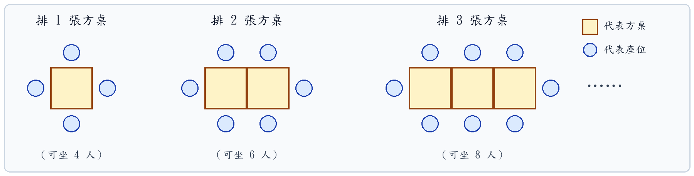

# 臺中市鹿陽國民小學 115 學年度第一學期 六年級數學領域期中定期評量試卷

**命題範圍：康軒版第 1 單元 ～ 第 5 單元**  
**考試時間：40 分鐘　　滿分：100 分**  
**六年 ______ 班　座號：______　姓名：________________　得分：____________**

---

### 🌟 主題情境導讀：【綠動校園・創客永續——鹿陽國小60週年校慶園遊會】
> 鹿陽國小即將迎來 60 週年校慶！六年級各班自治籌備委員正緊鑼密鼓展開會場規劃、特色工坊手作、資材採購比價以及營運結算。請你發揮敏銳的數學素養與精準運算能力，協助各組同學解決籌備過程中遇到的各項挑戰！

---

### 一、 觀念辨析選擇題（每題 2 分，共 10 分）

(　　) **1.** 籌備會要挑選編號為「質數」的幸運攤位號碼。下列關於質數、合數與互質的敘述，哪一個是**正確**的？  
　　　① 所有的偶數都是合數  
　　　② 互質的兩個整數一定都是質數  
　　　③ 最小的質數是 2，最小的合數是 4  
　　　④ 兩個大於 1 的整數相乘，積一定是質數

(　　) **2.** 烘焙組計算分裝包數時列出算式「$A \div \dfrac{3}{4} = B$」。若原本原料重量 $A > 0$，請問分裝後的包數 $B$ 和原本重量 $A$ 的大小關係為何？  
　　　① $B > A$  
　　　② $B < A$  
　　　③ $B = A$  
　　　④ 無法比較

(　　) **3.** 會場服務台紀錄兩位志工的年齡，今年組長 12 歲、指導老師 36 歲。請問 8 年後兩人年齡的關係，下列哪一項敘述是**正確**的？  
　　　① 指導老師比組長大 32 歲  
　　　② 指導老師的年齡依然是組長的 3 倍  
　　　③ 兩人的年齡差距依然是 24 歲  
　　　④ 兩人的年齡總和與今年相同

(　　) **4.** 宣傳組用直式計算橫幅印刷長度「$15.6 \div 1.2$」，將被除數與除數的小數點同時向右移動一位後進行計算。請問算出來的「商」，其小數點應如何對齊？  
　　　① 必須對齊被除數原來的小數點  
　　　② 必須對齊被除數移動後的新小數點  
　　　③ 必須對齊除數移動後的小數點  
　　　④ 只要點在最後面整數位置即可

(　　) **5.** 飲品工坊標示特調飲品配方為「檸檬汁對綠茶的容量比是 $3 : 8$」。下列關於這個比的敘述，哪一個是**錯誤**的？  
　　　① 3 是比的前項，8 是比的後項  
　　　② 這個比的比值是 $\dfrac{3}{8}$  
　　　③ 如果檸檬汁倒入 $30\text{ mL}$，綠茶就需要倒入 $80\text{ mL}$  
　　　④ 檸檬汁的容量占整杯特調飲品的 $\dfrac{3}{8}$

---

### 二、 展區規格填填看（每格 2 分，共 20 分）

**1.【木工創客攤位的木條裁切與正方形邊框拼湊】**  
　木工組有長度分別為 $72\text{ cm}$ 與 $90\text{ cm}$ 的兩種木條，準備用來製作展示架與邊框：  
　(1) 若拿一根 $72\text{ cm}$ 和一根 $90\text{ cm}$ 的木條，想將它們全部裁切成每段一樣長的小木段，且剛好切完沒有剩餘，裁切出來的小木段最長是（　　　　　）$\text{cm}$。  
　(2) 若改用許多根 $72\text{ cm}$ 的木條連接拼湊成邊框的一邊，另一邊則用許多根 $90\text{ cm}$ 的木條連接拼湊。如果要拼湊成一個「**正方形的邊框**」，這個正方形最短的邊長是（　　　　　）$\text{cm}$。

**2.【烘焙攤位的原料填充與分裝盒數比較】**  
　烘焙組正在清點果露與奶油的分裝規格：  
　(1) 桌上有一瓶容量為 $\dfrac{4}{5}$ 公升的空玻璃瓶，組員將 $\dfrac{8}{15}$ 公升的濃縮百香果露全部倒進瓶中，請問果露占了這個玻璃瓶容量的（　　　　　）（答案請化為最簡分數）。  
　(2) 另有甲、乙兩桶各重 $4\dfrac{1}{2}$ 公斤的奶油：甲桶每 $\dfrac{7}{6}$ 公斤裝成一盒，乙桶每 $\dfrac{6}{7}$ 公斤裝成一盒。不用計算，請比較兩桶裝出來的總盒數，在 □ 裡填入 $>$、$<$ 或 $=$：  
　　　甲桶裝成的盒數 $4\dfrac{1}{2} \div \dfrac{7}{6}$　□　乙桶裝成的盒數 $4\dfrac{1}{2} \div \dfrac{6}{7}$

**3.【美食休息區的野餐方桌拼接規律】**  
　場務組在休息區將「每張四邊各坐 1 人（單張可坐 4 人）」的正方形野餐桌，一張接一張緊密排成一長排（兩張桌子相接的邊不能坐人，如下圖）：  

　(1) 依照上圖的排列規律，當排成 $n$ 張正方形桌子時，總共可以坐（　　　　　）人。（請以含有 $n$ 的算式表示）  
　(2) 若場務組在休息區排出一條由 15 張正方形桌子接成的長桌，總共可以提供（　　　　　）個座位。

**4.【宣傳組的錦旗裁切與彩帶條數比較】**  
　宣傳組買了一捆長 $3.6$ 公尺的紅布條，以及第一卷、第二卷各長 $52.8$ 公尺的金色裝飾彩帶：  
　(1) 將長 $3.6$ 公尺的紅布條，每 $0.45$ 公尺剪成一段製作三角錦旗，剛好可以剪成（　　　　　）段。  
　(2) 兩卷各長 $52.8$ 公尺的金色裝飾彩帶中，第一卷每 $0.96$ 公尺剪成一條，第二卷每 $1.05$ 公尺剪成一條。不用計算，請比較兩卷剪出來的彩帶總條數，在 □ 裡填入 $>$、$<$ 或 $=$：  
　　　第一卷剪出的條數 $52.8 \div 0.96$　□　第二卷剪出的條數 $52.8 \div 1.05$

**5.【紀念品攤位的校慶徽章禮盒配置】**  
　紀念品攤位推出「60週年經典徽章組」，規定每個標準禮盒內都固定放入 15 枚銀色校徽與 9 枚金色校徽：  
　(1) 標準禮盒中，「銀色校徽數量」對「金色校徽數量」的比值是（　　　　　）（請化為最簡分數）。  
　(2) 為了推出「典藏大禮盒」，籌備組決定維持相同的金、銀校徽比例進行擴充。若一個典藏大禮盒中放入了 24 枚金色校徽，則應該搭配放入（　　　　　）枚銀色校徽。

---

### 三、 工坊實作核心精算題（每題 4 分，共 20 分）
*(請在題目下方空白處寫出完整的直式或計算過程，答案需化至最簡)*

**1.【紀念禮盒分裝】**  
籌備會收到贊助的 84 瓶能量飲與 126 盒營養棒，要分裝成慰勞禮包平分給工作人員，每包的能量飲一樣多，營養棒也一樣多，且剛好分完。**請用短除法求出**：最多可以分裝成幾包？此時每包有幾瓶能量飲和幾盒營養棒？  
     

**2.【穀物烘焙用量】**  
烘焙工坊製作一整盤燕麥餅乾需要 $1\dfrac{3}{5}\text{ kg}$ 的有機麵粉，廚房現有 $5\dfrac{1}{3}\text{ kg}$ 的麵粉。請問廚房的麵粉一共可以製作多少盤燕麥餅乾？（答案用最簡分數表示）  
     

**3.【蜂巢展架幾何規律】**  
創客組利用木條拼接成相連的正六邊形蜂巢造型展示架。排 1 個正六邊形需要 6 根木條；每多排 1 個相連的正六邊形，因為共用一條邊，只需要增加 5 根木條（排 1 個用 6 根、排 2 個用 11 根、排 3 個用 16 根……）。  
(1) 寫出排 $n$ 個相連正六邊形所需木條數量的關係式。（2分）  
(2) 若組內目前共有 106 根木條，最多可以圍出幾個相連的正六邊形？（2分）  
     

**4.【清潔洗劑分裝】**  
大會進貨了 $39.1\text{ L}$ 的天然茶樹洗手乳，準備分裝到容量為 $0.85\text{ L}$ 的小按壓瓶中供各攤位使用。請問剛好可以裝滿多少瓶？（**請列出直式計算**）  
     

**5.【原料配方化簡】**  
請將下列各組原料配方的比化為**最簡整數比**：（每小題 2 分，共 4 分）  
(1) 麵粉與特級奶油的重量比是 $1.75 : 0.7$。  
(2) 濃縮果汁與氣泡水的容量比是 $\dfrac{5}{6} : 1\dfrac{1}{4}$。  
     

---

### 四、 園遊會營運情境素養應用題（每題 5 分，共 50 分）
*(請寫出計算過程與單位，否則不予計分)*

#### 【模組 A：會場動線與綠蔭大道】
**1.** 園遊會迎賓入口是一條全長 $480\text{ m}$ 的綠蔭大道，籌備組計畫在**大道單側**擺放校慶彩旗，從起點到終點**兩端都要插旗**，相鄰兩面彩旗之間的間距均為 $15\text{ m}$。請問一共需要準備多少面彩旗？  
     

**2.** 校園中央有一座圓形生態景觀池，池塘周長為 $180\text{ m}$。為了夜間晚會安全，大會沿著生態池的周圍每隔 $4.5\text{ m}$ 設置一盞景觀地燈。請問繞著生態池一周一共需要設置幾盞地燈？  
     

**3.** 舞台區前方有一塊長 $360\text{ cm}$、寬 $240\text{ cm}$ 的長方形展演平台，籌備組要用大小相同且邊長為整數公分的正方形防滑地墊鋪滿整塊平台，地墊不能切割且剛好鋪滿。請問防滑地墊的最大邊長是多少公分？此時最少需要幾塊地墊？  
     

**4.** 校慶主舞台設置了節能燈光秀，綠色雷射燈每隔 24 秒旋轉一次，藍色追光燈每隔 36 秒閃爍一次。上午 9:00 時兩盞燈同時啟動。  
(1) 請問下一次兩盞燈同時動作是在上午 9 點幾分幾秒？（3分）  
(2) 從上午 9:00 到 9:06 期間（包含 9:00 與 9:06），兩盞燈一共同時動作了幾次？（2分）  
     

#### 【模組 B：烘焙工坊與綠色物資採購】
**5.** 手作烘焙組將剛出爐的 $12\text{ kg}$ 減碳燕麥餅乾分裝成小袋出售，每小袋裝 $\dfrac{3}{8}\text{ kg}$。工坊一共可以裝成幾袋？若每小袋餅乾定價為 65 元且全數售罄，烘焙組共可獲得多少元？  
     

**6.** 小農市集運來一桶特級龍眼蜂蜜，製作蜜香紅茶用去了整桶蜂蜜的 $\dfrac{5}{7}$，秤重得知用去了 $3\dfrac{3}{4}\text{ kg}$。請問這桶蜂蜜原本未開封時的總重量是多少公斤？  
     

**7.** 物資巡邏組志工騎乘綠能電動車在會場各展區配送物資，連續行駛了 $5.76\text{ km}$，儀表板記錄共花了 $12.8\text{ 分鐘}$。請問志工平均每分鐘行駛多少公里？  
     

**8.** 自治會為點心攤位採購爆米花玉米粒，走訪市場兩家農會：  
• **甲農會**：一袋重量 $2.4\text{ kg}$，特價 158 元。  
• **乙農會**：一袋重量 $3.5\text{ kg}$，特價 235 元。  
請分別用**四捨五入法求商到小數點後第一位**，算出兩家農會每公斤玉米粒的單價，並說明買哪一家農會的玉米粒比較划算？  
     

#### 【模組 C：特調工坊與利潤分配】
**9.** 飲品工坊推出人氣商品「招牌翡翠檸檬飲」，店長黃金配方規定「新鮮檸檬原汁對綠茶的容量比是 $2 : 15$」。今天工坊準備調製一大桶飲品，已經倒入 $450\text{ mL}$ 的新鮮檸檬原汁，請問需要加入多少毫升的綠茶？  
     

**10.** 園遊會圓滿落幕，六年一班與六年二班合辦的創客市集扣除所有食材成本後，共結餘淨利潤 9600 元。兩班自治會協商，決定依照當天各班投入的志工服務總時數進行按比例分配：六年一班服務總時數為 35 小時，六年二班為 45 小時。請問六年一班和六年二班各可分得多少元的盈餘？  
     
